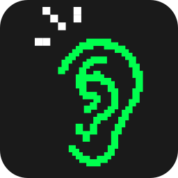

<p align="center">
  
</p>

<h1 align="center">Yap</h1>

<p align="center">
  Dictate anywhere. Free and local-first.
  <br>
  Speech-to-text powered by <a href="https://github.com/ggerganov/whisper.cpp">whisper.cpp</a> or <a href="https://openai.com/research/whisper">OpenAI Whisper</a>.
</p>

<p align="center">
  <a href="#about">About</a> ·
  <a href="#download">Download</a> ·
  <a href="#features">Features</a> ·
  <a href="#installation">Installation</a> ·
  <a href="#development">Development</a> ·
  <a href="#documentation">Documentation</a>
</p>

---

## About

Yap is a desktop application that transcribes your speech and automatically pastes the text into any application. Press a hotkey, speak, and your words appear wherever your cursor is.

Choose between **local transcription** using [whisper.cpp](https://github.com/ggerganov/whisper.cpp) for complete privacy and offline use, or **cloud transcription** via OpenAI's Whisper API for maximum accuracy.

Built with [Wails](https://wails.io/) (Go + React).

## Download

| Platform | Download |
|----------|----------|
| **macOS** (Apple Silicon, Intel via Rosetta) | [DMG Installer](https://github.com/ApplauseLab/yap/releases/latest) |
| **Windows** (x64) | [Installer](https://github.com/ApplauseLab/yap/releases/latest) |
| **Linux** (x64) | [AppImage](https://github.com/ApplauseLab/yap/releases/latest) · [DEB](https://github.com/ApplauseLab/yap/releases/latest) |

On Windows and Linux, the bundled local transcription runtime requires an x64 CPU with AVX2 (Intel Haswell / AMD Excavator or newer; some Pentium, Celeron, and Atom models lack it). Cloud transcription works on any CPU.

See all versions on the [Releases page](https://github.com/ApplauseLab/yap/releases).

## Features

- **Global Hotkey** — Start recording with a single keypress (Option key on macOS)
- **Local Transcription** — Offline, private speech-to-text using whisper.cpp
- **Cloud Transcription** — OpenAI Whisper API for higher accuracy (optional)
- **Auto-Paste** — Transcribed text is automatically pasted into the active application
- **Multiple Models** — Choose from tiny, base, small, medium, or large models
- **Transcription History** — Review, replay, and copy past transcriptions
- **System Tray** — Quick access from the menu bar
- **Audio Device Selection** — Choose your preferred microphone

### Whisper Models

| Model | Size | Speed | Accuracy |
|-------|------|-------|----------|
| tiny | ~75 MB | Fastest | Basic |
| base | ~150 MB | Fast | Good |
| small | ~500 MB | Medium | Better |
| medium | ~1.5 GB | Slow | High |
| large-v3 | ~3 GB | Slowest | Highest |

English-only models (e.g., `base.en`) are faster and more accurate for English.

## Installation

### Download Release

1. Download the installer for your platform from the [Releases page](https://github.com/ApplauseLab/yap/releases/latest)
2. **macOS**: Open the DMG and drag to Applications
3. **Windows**: Run the installer
4. **Linux**: `chmod +x *.AppImage && ./Yap-*.AppImage` or `sudo dpkg -i *.deb`

### Linux on Wayland (Omarchy, Hyprland, Sway, GNOME, KDE)

Wayland does not let applications grab global keys or type into other windows, so Yap works with your compositor instead:

- **Shortcuts** are bound in the compositor to `yap toggle` and `yap cancel`, which control the running app. Settings → Keyboard Shortcuts shows the exact lines for your setup.
- **Clipboard** uses `wl-copy`/`wl-paste` from `wl-clipboard`.
- **Auto-paste** asks Hyprland to send the paste shortcut (Ctrl+Shift+V in terminals), and otherwise uses `wtype`, then `ydotool`.

On Arch Linux / Omarchy, use the `ubuntu24` AppImage and install its dependencies:

```bash
sudo pacman -S --needed webkit2gtk-4.1 gtk3 fuse2 wl-clipboard wtype
chmod +x Yap-*-Linux-ubuntu24.AppImage && ./Yap-*-Linux-ubuntu24.AppImage
```

Then bind the shortcuts. On Omarchy 4, add to `~/.config/hypr/bindings.lua`:

```lua
o.bind("SUPER + ALT + Y", "Yap dictation", "/path/to/Yap.AppImage toggle")
o.bind("SUPER + ALT + ESCAPE", "Yap cancel", "/path/to/Yap.AppImage cancel")
```

Plain Hyprland with a Lua config uses `hl.bind("SUPER + ALT + Y", hl.dsp.exec_cmd("/path/to/Yap.AppImage toggle"))`; a `.conf` config (Hyprland before 0.55, Omarchy 3) uses `bind = SUPER ALT, Y, exec, /path/to/Yap.AppImage toggle`. On other desktops, bind the same commands in the keyboard settings.

| Command | Action |
|---------|--------|
| `yap toggle` | Start recording, or stop and transcribe |
| `yap start` / `yap stop` | Start, or stop and transcribe |
| `yap cancel` | Discard the current recording |
| `yap show` | Show the Yap window |
| `yap status` | Print `ready`, `recording`, `transcribing`, or `error` |

Launching Yap while it is already running shows the existing window. If the window stays blank on NVIDIA, start Yap with `WEBKIT_DISABLE_DMABUF_RENDERER=1`.

X11 sessions are unchanged: Yap registers the hotkey itself and pastes with `xdotool`.

### Build from Source

#### Prerequisites

- [Go](https://golang.org/) 1.21+
- [Node.js](https://nodejs.org/) 18+
- [Wails CLI](https://wails.io/docs/gettingstarted/installation)
- [PortAudio](https://www.portaudio.com/)

```bash
# macOS
brew install portaudio

# Ubuntu/Debian
sudo apt-get install portaudio19-dev

# Arch Linux (build with: wails build -tags webkit2_41)
sudo pacman -S --needed go npm gtk3 webkit2gtk-4.1 portaudio

# For local transcription (optional)
brew install whisper-cpp  # macOS
# Or build from source: https://github.com/ggerganov/whisper.cpp
```

#### Build

```bash
git clone https://github.com/ApplauseLab/yap.git
cd yap

# Install Wails CLI
go install github.com/wailsapp/wails/v2/cmd/wails@latest

# Build
wails build

# Run
open build/bin/Yap.app  # macOS
```

## Development

```bash
# Install dependencies
cd frontend && npm install && cd ..

# Run in development mode with hot reload
wails dev
```

### Permissions (macOS)

The app requires the following permissions:

- **Microphone** — For audio recording
- **Accessibility** — For global hotkey and auto-paste functionality

### Debug Logs

Yap writes debug logs to help investigate unexpected user behavior. Logs are kept for 7 days.

- macOS: `~/Library/Application Support/yap/logs/yap-YYYY-MM-DD.log`
- Windows: `%APPDATA%\yap\logs\yap-YYYY-MM-DD.log`
- Linux: `~/.config/yap/logs/yap-YYYY-MM-DD.log`

If Yap quits unexpectedly, the crash output (panic or native crash stack traces) is in `yap-stderr-YYYY-MM-DD.log` in the same folder, and the next launch logs a warning that the previous session did not shut down cleanly.

## Documentation

For comprehensive documentation, visit **[applauselab.ai/docs/yap](https://applauselab.ai/docs/yap/)**.

- [Getting Started](https://applauselab.ai/docs/yap/getting-started/) — Installation, quick start, and permissions
- [User Guide](https://applauselab.ai/docs/yap/user-guide/) — Recording, transcription, models, history, and settings
- [Developer Guide](https://applauselab.ai/docs/yap/developer/) — Building from source, project structure, and contributing
- [Reference](https://applauselab.ai/docs/yap/reference/) — API reference, configuration, troubleshooting, and FAQ

## Contributing

Contributions are welcome! Please feel free to submit a Pull Request.

### Commit Convention

This project uses [Conventional Commits](https://www.conventionalcommits.org/). Commit messages are validated using commitlint.

```
feat: add new feature
fix: resolve bug
docs: update documentation
chore: maintenance task
```

## License

[MIT License](LICENSE) — Copyright (c) 2024 [Applause Lab](https://applauselab.ai)
